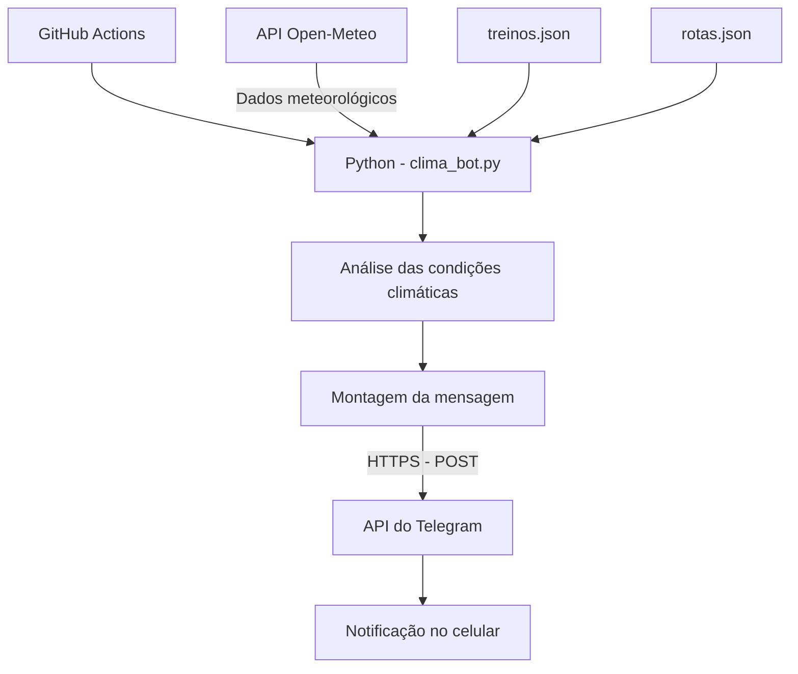
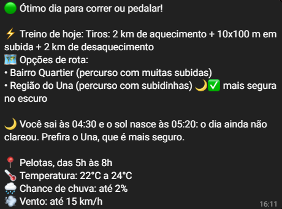
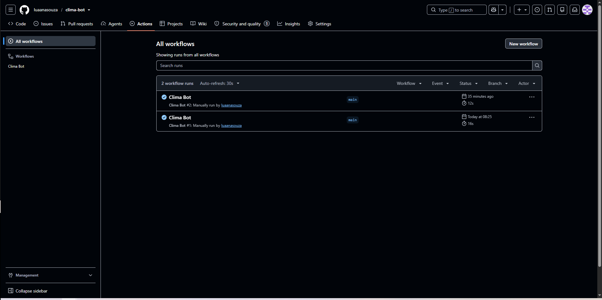

# Treinador do Dia 🏃‍♀️ 🚴‍♀️

### Automação de rotina esportiva com Python e integração de APIs

**Acadêmica:** Luana Couto  
**Disciplina:** Automação e Programabilidade em Redes  
**Professor:** Wagner Loch  
**Ano:** 2026  

---

## 1. Apresentação do projeto

Este projeto foi desenvolvido com o objetivo de automatizar algumas consultas que realizo diariamente para organizar meus treinos de corrida e ciclismo.

Antes de realizar um treino, normalmente preciso consultar a previsão do tempo, verificar meu planejamento e escolher um percurso adequado. A partir dessa necessidade, desenvolvi uma automação que reúne essas informações e envia uma mensagem pelo Telegram na noite anterior ao treino.

O programa consulta a previsão do tempo em Pelotas – RS, considerando o período das 5h às 8h, identifica o treino programado e apresenta as opções de percurso cadastradas, além de alertas relacionados às condições climáticas.

A proposta é facilitar o planejamento da minha rotina esportiva e aplicar, de forma prática, os conhecimentos da disciplina de Automação e Programabilidade em Redes.

## 2. Arquitetura e funcionamento

O projeto utiliza Python como linguagem principal, sendo responsável pela comunicação com as APIs, leitura dos arquivos JSON, análise das condições climáticas e montagem da mensagem.

A execução é automatizada pelo GitHub Actions, permitindo que o programa funcione na nuvem sem a necessidade de manter meu computador ligado.

### Fluxo de funcionamento

1. O GitHub Actions inicia a execução do programa.
2. O Python identifica a data do próximo treino.
3. O programa consulta a API Open-Meteo.
4. Os dados meteorológicos são analisados considerando o período das 5h às 8h.
5. O programa consulta os arquivos JSON de treinos e percursos.
6. As condições climáticas são classificadas conforme os limites definidos no código.
7. O Python organiza as informações e monta a mensagem.
8. A mensagem é enviada ao Telegram por meio de sua API.

### Representação da arquitetura



### Cadastro dos treinos e percursos

Como já possuo meu próprio planejamento de corrida e ciclismo, realizei o cadastro manual dos treinos e percursos nos arquivos JSON.

O arquivo `treinos.json` contém o planejamento dos treinos, enquanto o arquivo `rotas.json` armazena as informações dos percursos cadastrados.

O programa consulta esses arquivos de acordo com a data do próximo treino e reúne as informações com a previsão do tempo.

Dessa forma, consigo atualizar meu planejamento sem precisar modificar o código principal em Python.

### Classificação das condições climáticas

O programa analisa a probabilidade de chuva, a velocidade do vento e a temperatura, utilizando limites definidos no código.

| Parâmetro | Valor de referência |
|---|---|
| Horário inicial da análise | 5h |
| Horário final da análise | 8h |
| Probabilidade máxima de chuva | 40% |
| Velocidade máxima do vento | 25 km/h |
| Temperatura mínima | 8°C |
| Temperatura máxima | 28°C |

A partir dessa análise, o programa classifica as condições climáticas em três níveis:

- 🟢 **Verde:** nenhum alerta identificado.
- 🟡 **Amarelo:** um alerta identificado, indicando necessidade de atenção.
- 🔴 **Vermelho:** dois ou mais alertas identificados.

Essa classificação auxilia no planejamento do treino, mas não substitui a avaliação das condições reais no momento da atividade.

## 3. Tecnologias e conceitos utilizados

| Tecnologia | Aplicação no projeto |
|---|---|
| Python | Processamento dos dados e lógica da automação. |
| Open-Meteo API | Consulta da previsão do tempo. |
| Telegram Bot API | Envio das mensagens. |
| JSON | Organização e armazenamento dos dados. |
| GitHub | Armazenamento e versionamento do projeto. |
| GitHub Actions | Execução automatizada na nuvem. |
| Requests | Biblioteca Python utilizada para realizar requisições HTTP. |
| HTTPS | Proteção da comunicação com as APIs. |
| YAML | Configuração do workflow de automação. |
| Cron | Agendamento das execuções automáticas. |
| GitHub Secrets | Armazenamento protegido das credenciais. |

### Comunicação em rede

A comunicação entre o programa e os serviços externos ocorre por meio de APIs, utilizando o protocolo HTTPS.

Uma API permite que diferentes sistemas se comuniquem e troquem informações sem a necessidade de intervenção manual.

No projeto, são utilizados dois métodos HTTP:

- **GET:** utilizado para consultar as informações meteorológicas na API Open-Meteo.
- **POST:** utilizado para enviar a mensagem pela API do Telegram.

O HTTPS utiliza criptografia para proteger os dados durante a comunicação entre o programa e os servidores externos.

As informações meteorológicas são recebidas no formato JSON, permitindo que o Python interprete e utilize os dados na montagem da mensagem.

### Segurança das informações

Para evitar a exposição das credenciais do Telegram, são utilizadas variáveis de ambiente e o GitHub Secrets.

O token do bot e o identificador do chat não devem ser publicados diretamente no código-fonte.

O arquivo `.env.example` serve como modelo para a configuração local, enquanto o arquivo `.gitignore` deve impedir que o arquivo `.env`, contendo as credenciais reais, seja enviado ao repositório.

### Tratamento de erros

O projeto utiliza mecanismos de tratamento de erros para lidar com possíveis falhas durante a execução, como problemas de conexão ou indisponibilidade das APIs.

Em Python, a estrutura `try` e `except` permite tentar executar uma operação e tratar determinadas falhas que possam ocorrer.

Também é utilizado um limite de tempo de espera nas requisições (timeout), evitando que o programa fique aguardando indefinidamente por uma resposta.

Os registros de execução do GitHub Actions auxiliam na identificação e investigação de problemas.

## 4. Estrutura e execução do projeto

### Estrutura dos arquivos

```text
clima-bot/
├── .github/
│   └── workflows/
│       └── clima.yml
├── clima_bot.py
├── treinos.json
├── rotas.json
├── requirements.txt
├── .env.example
├── .gitignore
├── demo-telegram.png
├── demo-actions.png
└── README.md
```

### Função de cada arquivo

| Arquivo | Função |
|---|---|
| `clima_bot.py` | Código principal da automação. |
| `treinos.json` | Armazena os treinos cadastrados manualmente. |
| `rotas.json` | Armazena os percursos cadastrados manualmente. |
| `requirements.txt` | Lista as dependências necessárias para executar o programa. |
| `clima.yml` | Configura a execução automática pelo GitHub Actions. |
| `.env.example` | Modelo de configuração das variáveis de ambiente. |
| `.gitignore` | Define os arquivos que não devem ser enviados ao repositório. |
| `README.md` | Documentação do projeto. |
| `demo-telegram.png` | Captura de tela da mensagem recebida. |
| `demo-actions.png` | Captura de tela da execução da automação. |

### Passo 1 — Clonar o repositório

```bash
git clone https://github.com/luaanasouza/clima-bot.git
cd clima-bot
```

### Passo 2 — Instalar as dependências

É necessário possuir o Python instalado para realizar a execução local.

```bash
pip install -r requirements.txt
```

### Passo 3 — Configurar o Telegram

Criar um bot utilizando o BotFather no Telegram e obter o token de autenticação e o identificador do chat.

Para execução local, utilizar o arquivo `.env.example` como referência para configurar as variáveis de ambiente necessárias.

Para execução pelo GitHub Actions, cadastrar as credenciais correspondentes em:

`Settings > Secrets and variables > Actions`

As credenciais reais não devem ser compartilhadas ou publicadas no repositório.

### Passo 4 — Execução automática

O GitHub Actions é responsável pela execução diária da automação na nuvem.

O programa foi desenvolvido para enviar a mensagem no período da noite, permitindo que eu organize o treino da manhã seguinte.

O agendamento é configurado no arquivo `.github/workflows/clima.yml` por meio de uma expressão cron.

Quando configurado em UTC, é necessário considerar a diferença de três horas em relação ao horário de Brasília.

O horário de execução pode sofrer atrasos devido à disponibilidade dos servidores do GitHub.

### Passo 5 — Execução manual

Também é possível testar a automação diretamente pelo GitHub:

1. Acessar a aba **Actions**.
2. Selecionar o workflow do projeto.
3. Clicar em **Run workflow**.
4. Acompanhar os registros de execução.
5. Verificar o recebimento da mensagem no Telegram.

### Execução local

Após instalar as dependências e configurar as variáveis de ambiente, executar:

```bash
python clima_bot.py
```

### Atualização dos treinos

Para cadastrar ou alterar um treino, basta editar o arquivo `treinos.json`, mantendo a estrutura e o formato das informações existentes.

O mesmo procedimento pode ser realizado no arquivo `rotas.json` para atualizar os percursos.

Não é necessário alterar a lógica principal do programa para atualizar essas informações.

## 5. Demonstração e resultados

O projeto permite reunir automaticamente informações que antes precisavam ser consultadas separadamente.

A mensagem enviada pelo Telegram apresenta:

- Data do treino.
- Treino programado.
- Opções de percurso cadastradas.
- Probabilidade de chuva.
- Temperatura mínima e máxima.
- Velocidade do vento.
- Classificação das condições climáticas.
- Alertas e recomendações conforme as condições analisadas.

### Mensagem recebida no Telegram

Exemplo de uma mensagem gerada pelo programa a partir da previsão do tempo e das informações cadastradas.



### Execução pelo GitHub Actions

Histórico das execuções realizadas pela automação na nuvem.



[Acessar o histórico de execuções do projeto](https://github.com/luaanasouza/clima-bot/actions/workflows/clima.yml)

### Conceitos da disciplina aplicados

| Conceito | Aplicação prática |
|---|---|
| Automação | Execução de tarefas sem intervenção manual. |
| Programabilidade | Utilização do Python para definir a lógica do programa. |
| Comunicação em rede | Troca de informações entre o programa e as APIs. |
| Requisições HTTP | Utilização dos métodos GET e POST. |
| Segurança | Comunicação HTTPS e proteção das credenciais. |
| Dados estruturados | Utilização de arquivos JSON. |
| Agendamento | Execução automática por meio do GitHub Actions. |
| Diagnóstico de falhas | Tratamento de erros e análise dos registros de execução. |

## 6. Melhorias futuras e limitações

### Melhorias futuras

- Integrar uma planilha para facilitar o cadastro dos treinos.
- Criar um histórico das condições climáticas em formato CSV.
- Integrar uma API de rotas e elevação.
- Adicionar novas opções de personalização dos alertas.
- Implementar um controle para evitar notificações duplicadas.
- Permitir a atualização dos treinos diretamente pelo Telegram.

### Limitações atuais

- Os treinos e percursos precisam ser cadastrados manualmente.
- O programa utiliza previsões meteorológicas e não realiza monitoramento em tempo real.
- Os percursos são cadastrados previamente, não sendo calculados automaticamente.
- As condições climáticas são classificadas com base nos limites definidos no código.
- As informações cadastradas sobre os percursos não representam uma garantia de segurança.
- O funcionamento depende da disponibilidade das APIs externas.
- A execução automática pode sofrer atrasos.

## 7. Conclusão

O desenvolvimento deste projeto me permitiu compreender melhor como diferentes sistemas podem se comunicar e trabalhar de forma integrada por meio da automação.

Consegui aplicar conceitos de programação, comunicação em rede, utilização de APIs, segurança das informações e execução de tarefas na nuvem em uma situação que faz parte da minha rotina.

Durante o desenvolvimento, utilizei inteligência artificial como ferramenta de apoio na construção e organização do código, buscando compreender a função de cada componente e como as tecnologias utilizadas se relacionam.

Além de facilitar meu planejamento esportivo, o projeto contribuiu para ampliar meus conhecimentos sobre automação e programabilidade de redes na prática.

## Referências

- [Documentação do Python](https://docs.python.org/3/)
- [Documentação da Open-Meteo API](https://open-meteo.com/en/docs)
- [Documentação da Telegram Bot API](https://core.telegram.org/bots/api)
- [Documentação do GitHub Actions](https://docs.github.com/en/actions)
- [Documentação da biblioteca Requests](https://requests.readthedocs.io/)
- [Documentação do JSON](https://www.json.org/)

---

Projeto acadêmico desenvolvido para a disciplina de Automação e Programabilidade em Redes — 2026.
